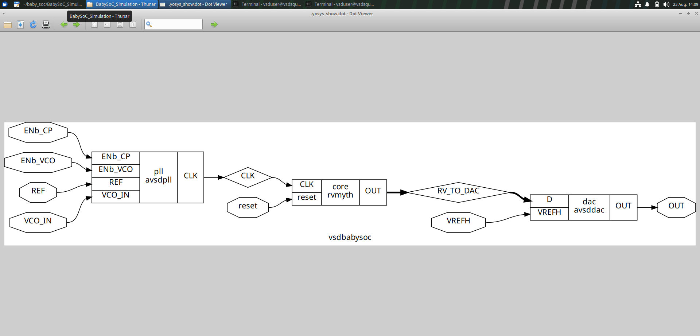
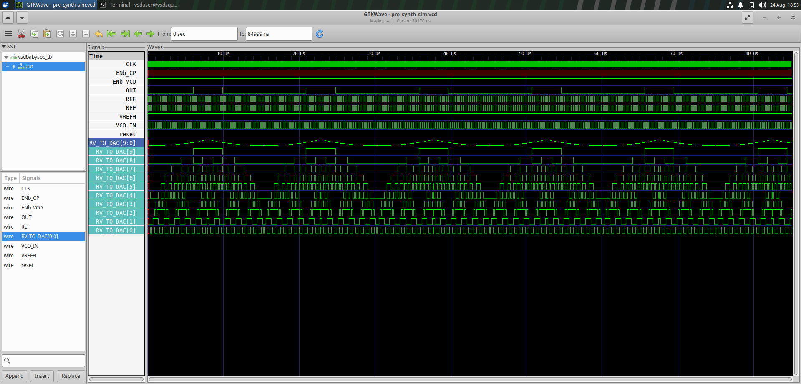
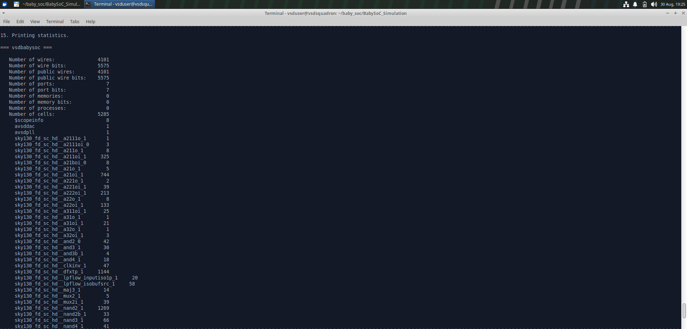
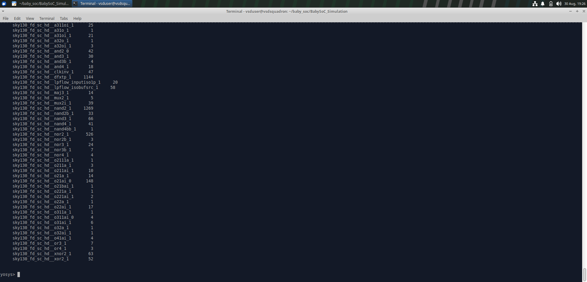
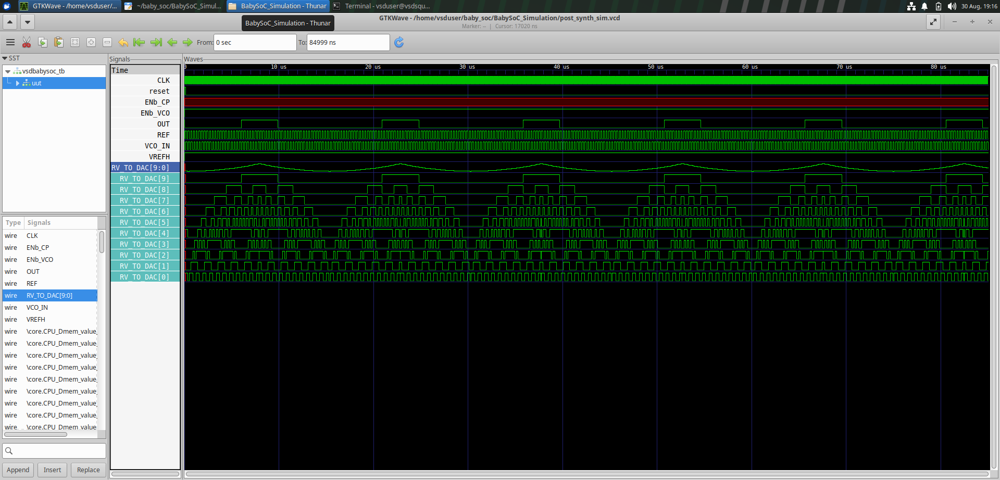

# VSDIAT BabySoC — RTL, Synthesis, Static Timing Analysis and Physical Design

This repository documents my hands-on work on **BabySoC design and ASIC implementation** as part of my VSDIAT / VLSI training. The project records the flow from RTL and functional simulation through synthesis, multi-corner static timing analysis (STA), and the physical-design stages reached so far.

> **Scope note:** The documented work currently extends through post-route STA. This README does not claim that the design is timing-closed, DRC-clean, LVS-clean, or ready for tape-out. See the physical-design evidence and limitations in [`physical_design/README.md`](physical_design/README.md).

---

## Project Overview

The BabySoC contains three major blocks:

- **RVMyth** — RISC-V-based digital processor core
- **AVSDPLL** — PLL block used for clock generation
- **AVSDDAC** — DAC block that converts the processor's digital output

The top-level module is:

```text
vsdbabysoc
```

## BabySoC Architecture

```text
                         ┌──────────────┐
 ENb_CP ────────────────►│              │
 ENb_VCO ───────────────►│   AVSDPLL    │
 REF ───────────────────►│     PLL      │─── CLK ───┐
 VCO_IN ────────────────►│              │            │
                         └──────────────┘            ▼
                                                ┌──────────┐
                                         reset ─►│  RVMyth  │
                                                │   CPU    │
                                                └────┬─────┘
                                                     │
                                                RV_TO_DAC[9:0]
                                                     │
                                                     ▼
                                                ┌──────────┐
                                         VREFH ─►│ AVSDDAC  │
                                                │   DAC    │
                                                └────┬─────┘
                                                     │
                                                     ▼
                                                    OUT
```

## Design Hierarchy

```text
vsdbabysoc
├── avsddpll
├── rvmyth
└── avsddac
```

The `rvmyth` block contains the main digital processing logic and generates the 10-bit bus `RV_TO_DAC[9:0]`, which is provided to the DAC. The PLL supplies the clock used by the digital core.

---

## Implementation Flow

```text
RTL
 │
 ▼
Pre-Synthesis Functional Simulation
 │
 ▼
Yosys Logic Synthesis
 │
 ▼
SKY130 Technology Mapping
 │
 ▼
Gate-Level Netlist
 │
 ▼
Post-Synthesis Functional Simulation
 │
 ▼
Pre-Layout Static Timing Analysis
 │
 ▼
Floorplanning
 │
 ▼
Placement
 │
 ▼
Clock Tree Synthesis (CTS)
 │
 ▼
Routing
 │
 ▼
Post-Route Static Timing Analysis
 │
 ▼
Further Physical Verification / Closure (not claimed complete)
```

## Project Progress

| Stage | Status | Notes |
|---|---|---|
| RTL design | Completed | BabySoC RTL used for the documented flow |
| Pre-synthesis simulation | Completed | Icarus Verilog and GTKWave |
| Yosys synthesis | Completed | Logic optimization and synthesis |
| SKY130 technology mapping | Completed | `sky130_fd_sc_hd` library |
| Gate-level netlist | Generated | Used for post-synthesis simulation |
| Post-synthesis simulation | Completed | Functional gate-level simulation |
| Pre-layout STA | Executed | 18-corner analysis documented |
| Floorplanning | Executed | Floorplan evidence documented; unconstrained pins are noted |
| Placement | Executed | Placement-stage evidence documented |
| Clock tree synthesis | Executed | CTS-stage evidence documented |
| Routing | Executed | Routing evidence exists; routing DRC short violations were observed |
| Post-route STA | Executed | 16-corner results documented; completion does not itself prove timing closure |
| DRC/LVS/signoff | Not established by this README | Do not interpret the available evidence as clean signoff |
| Final merged GDSII | Not established by this README | No claim of a verified, signoff-ready top-level GDSII |

For the detailed stage-by-stage evidence, results, and caveats, see [`physical_design/README.md`](physical_design/README.md).

---

# 1. RTL Design

The BabySoC RTL is described using **Verilog HDL**. The existing RTL files are maintained in the repository's `rtl/` directory.

The top-level module is `vsdbabysoc`. At RTL, the design describes intended hardware behavior without specifying every physical standard cell or the final layout.

# 2. Pre-Synthesis Simulation

The RTL was simulated using:

- **Icarus Verilog**
- **GTKWave**

The simulation flow is:

```text
RTL → Icarus Verilog → VCD waveform → GTKWave
```

Signals observed include `CLK`, `REF`, `reset`, `VCO_IN`, `VREFH`, `RV_TO_DAC[9:0]`, and `OUT`.

# 3. Logic Synthesis Using Yosys

**Yosys** was used to synthesize the RTL. The synthesis flow includes RTL reading, optimization, flip-flop mapping, logic optimization, and technology mapping.

The target standard-cell library is:

```text
sky130_fd_sc_hd
```

The typical Liberty file used in the documented synthesis setup is:

```text
sky130_fd_sc_hd__tt_025C_1v80.lib
```

Representative Yosys commands used in the flow include:

```text
read_verilog
dfflibmap
opt
abc
show
flatten
setundef -zero
clean -purge
rename -enumerate
write_verilog
```

In brief:

- `read_verilog` reads RTL source files.
- `dfflibmap` maps flip-flops to library cells.
- `opt` performs logic optimizations.
- `abc` performs logic optimization and technology mapping using the target library.
- `show` displays a design representation.
- `flatten` removes module hierarchy by incorporating lower-level logic into the parent.
- `setundef -zero` replaces undefined values with zero in the synthesized representation.
- `clean -purge` removes unused or redundant objects.
- `rename -enumerate` systematically renames generated objects.
- `write_verilog` writes the resulting netlist.

# 4. SKY130 Technology Mapping and Gate-Level Netlist

Technology mapping replaces generic logic with cells from the target standard-cell library. Examples of cell names include:

```text
sky130_fd_sc_hd__nand2_1
sky130_fd_sc_hd__nor2_1
sky130_fd_sc_hd__and2_0
sky130_fd_sc_hd__mux2_1
sky130_fd_sc_hd__xor2_1
sky130_fd_sc_hd__dfrtp_1
```

The synthesized netlist documented in the original flow is:

```text
baby_soc_netlist3.v
```

The actual repository path should be checked if this file is moved or renamed.

# 5. Post-Synthesis Simulation

The synthesized netlist was simulated using:

- Icarus Verilog
- SKY130 Verilog cell models
- The testbench
- GTKWave

The documented compile-time options were:

```text
-DPOST_SYNTH_SIM
-DFUNCTIONAL
-DUNIT_DELAY=#1
```

The functional gate-level simulation generated a VCD waveform. The RTL and synthesized waveforms were compared using signals including `CLK`, `REF`, `reset`, `RV_TO_DAC[9:0]`, and `OUT`.

**Interpretation:** Functional gate-level simulation checks logical behavior under the applied testbench. It is not the same as timing-aware gate-level simulation and does not replace STA.

# 6. Static Timing Analysis and Physical Design

The repository now documents the physical-design work from **pre-layout STA through post-route STA**. The detailed evidence is grouped under `physical_design/`:

| Stage | Documentation / evidence |
|---|---|
| Pre-layout STA | [`physical_design/pre_layout_sta/`](physical_design/pre_layout_sta/) |
| Floorplanning | [`physical_design/floorplanning/`](physical_design/floorplanning/) |
| Placement | [`physical_design/placement/`](physical_design/placement/) |
| Clock Tree Synthesis | [`physical_design/cts/`](physical_design/cts/) |
| Routing | [`physical_design/routing/`](physical_design/routing/) |
| Post-route STA | [`physical_design/post_route_sta/`](physical_design/post_route_sta/) |
| Overall physical-design notes | [`physical_design/README.md`](physical_design/README.md) |

### Important interpretation notes

- **Pre-layout STA:** The documented analysis covers 18 corners. Negative setup slack indicates setup timing violations for the relevant constraints and corners. Check the included reports for exact metrics and units.
- **Floorplanning:** The captured floorplan evidence reported 17 unconstrained pins. This should be documented as a constraint/setup limitation and investigated; it should not be hidden.
- **Placement and CTS:** GUI screenshots demonstrate that stages were run, but screenshots alone do not establish placement quality, clock skew acceptability, or timing closure.
- **Routing:** Routing-stage evidence is available, but short violations were observed in the available routing DRC report. Do not describe the routed design as DRC-clean unless a subsequent verified report supports that claim.
- **Post-route STA:** The documented run completed analysis for 16 corners. Run completion is not equivalent to passing setup and hold timing at every corner. Interpret the reported slack according to the source report's definitions and units.
- **GDSII and signoff:** Do not claim verified top-level GDSII generation, LVS cleanliness, signoff readiness, or timing closure unless the corresponding artifacts and reports are present and reviewed.

# 7. Results and Existing Simulation Evidence

The original results images remain linked below. Confirm that each file exists at the stated relative path and that the filename's capitalization matches the repository.

## BabySoC Architecture



## Pre-Synthesis Simulation



## Synthesis Results





## Post-Synthesis Simulation



Physical-design screenshots and reports are maintained separately under `physical_design/` so that the simulation/synthesis evidence and physical-design evidence remain organized.

---

# 8. Tools and Technologies

| Area | Tools / technology |
|---|---|
| HDL | Verilog HDL |
| Simulation | Icarus Verilog, GTKWave |
| Synthesis | Yosys, ABC |
| Standard-cell library | SKY130 `sky130_fd_sc_hd` |
| Timing analysis | STA tooling and Liberty timing models |
| Physical design | OpenROAD-based flow / OpenROAD GUI evidence |
| Environment | Linux |

---

# Key Learning

This project demonstrates the distinction between the main implementation representations:

- **RTL:** behavioral/structural hardware description.
- **Synthesized netlist:** technology-mapped standard-cell connectivity.
- **Physical implementation:** floorplan, placed cells, clock tree, and routed interconnect.
- **STA:** constraint-based analysis of timing paths at specified corners; it is not a functional simulation.
- **Physical verification:** DRC and LVS checks that must be supported by their own reports.

The central lesson is that progress through a flow stage does not automatically mean that the design passes that stage's quality checks. Timing, constraints, routing, and physical-verification results must be reviewed independently.

## Current Milestone

**Documented milestone:** RTL → post-synthesis functional simulation → pre-layout STA → floorplanning → placement → CTS → routing → post-route STA.

**Next engineering priority:** Review and resolve constraint issues and timing violations, investigate the reported routing DRC shorts, and collect verified reports for subsequent physical verification. Do not label the design signoff-ready until the relevant checks pass.
